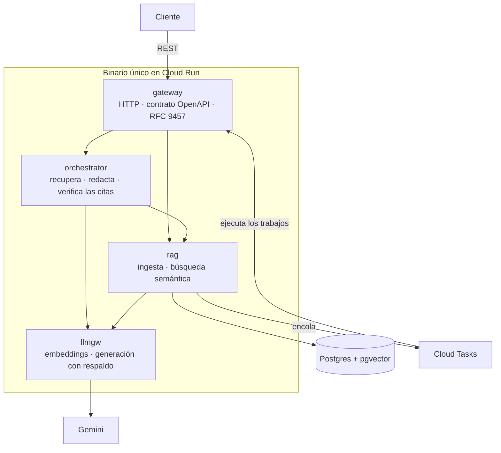

# AI Doc Platform

[](https://github.com/rodroguett/ai-doc-platform/actions/workflows/ci.yml)
[](https://github.com/rodroguett/ai-doc-platform/actions/workflows/deploy.yml)
[](https://go.dev)

Sistema de consulta sobre documentos regulatorios que responde en lenguaje
natural **citando la fuente exacta**, con control explícito del costo por
consulta y degradación controlada cuando el proveedor de generación falla.

El caso de uso que guía el diseño es el cumplimiento ambiental en la minería
chilena: una Resolución de Calificación Ambiental contiene cientos de
compromisos vinculantes repartidos entre el documento original, sus adendas y
los informes de seguimiento. Responder "¿qué comprometimos sobre el monitoreo
de material particulado?" hoy toma horas de búsqueda manual.

En un sector fiscalizado, **la trazabilidad de la respuesta importa más que su
fluidez**: una respuesta sin fuente verificable no sirve. Esa restricción es la
que ordena la arquitectura.

## Estado

En construcción. Este repositorio documenta el proceso, no solo el resultado:
las decisiones de diseño están registradas como
[ADRs](docs/adr/) y el historial de commits refleja la evolución real del
sistema, incluidos los errores y sus correcciones.

Hoy el sistema es **un solo binario desplegado en Cloud Run**, conectado a
Postgres con pgvector. Al subir un PDF, su texto se extrae y se divide en
fragmentos que conservan su ubicación; un trabajo en segundo plano genera el
embedding de cada uno. Una consulta recupera los pasajes del corpus que la
sustentan, y un modelo redacta la respuesta a partir de ellos, marcando en
cada afirmación el pasaje que la respalda. La respuesta se entrega solo si
sus citas apuntan a pasajes que existen.

Cuando el modelo no responde, o su respuesta no cita, la consulta se entrega
en **modo degradado**: los pasajes, sin texto redactado, y la traza lo
declara. Con la capa gratuita del proveedor eso ocurre con frecuencia.

| Módulo | Estado |
|---|---|
| `gateway` | Desplegado. Documentos y trabajos operan sobre Postgres; `POST /v1/queries` responde con datos de ejemplo; `GET /v1/usage`, 501 |
| `rag` | Ingesta completa y búsqueda por similitud: extrae el texto de un PDF, lo fragmenta por considerandos y secciones, genera sus embeddings en un trabajo reanudable, y recupera los pasajes más parecidos a una pregunta |
| `orchestrator` | Responde consultas: recupera los pasajes, descarta los que no alcanzan un puntaje mínimo, pide la redacción a un modelo y verifica que cada cita apunte a un pasaje real. Si el modelo falla, responde en modo degradado. Caché de preguntas repetidas y tope diario |
| `llmgw` | Embeddings y generación con Gemini detrás de interfaces que ocultan al proveedor. Respaldo entre dos modelos de generación; reintentos y ritmo regulado para los embeddings. Pendiente: conteo de costos persistente |

Demo: **https://gateway-w46qaen3gq-uc.a.run.app/docs** — la API es explorable y
ejecutable desde el navegador.

```bash
curl -s https://gateway-w46qaen3gq-uc.a.run.app/v1/queries \
  -H 'Content-Type: application/json' \
  -d '{"question": "¿Con qué frecuencia se monitorea el agua subterránea?"}'
```

La respuesta se redacta a partir de la RCA del proyecto "Continuidad
Operacional Minera Tres Valles": cada afirmación lleva la marca de su cita, y
cada cita trae el considerando y las páginas donde verificarla. La traza dice
qué modelo la redactó, con cuántos tokens y en cuánto tiempo; si dice
`"degraded": true`, ningún modelo la redactó y lo que se entrega son los
pasajes.

## Arquitectura

El sistema se construye como un **monolito modular**: un binario con cuatro
módulos de fronteras explícitas, que se extraerán como servicios
independientes solo cuando una condición concreta lo justifique. El
razonamiento y esas condiciones están en
[ADR-0005](docs/adr/0005-monolito-modular.md).



**Cada módulo expone un contrato y oculta su implementación.** Otro módulo solo
puede importar su paquete raíz, nunca sus subpaquetes, y nadie importa el
gateway. La regla se verifica en CI con `depguard`. Cuando un módulo se
extraiga, ese paquete raíz se convertirá en su contrato gRPC.

**La ingesta es asíncrona y reanudable.** Subir un documento responde `202
Accepted` con un trabajo cuyo avance puede consultarse. Como Cloud Run solo
asigna CPU mientras atiende una petición, el trabajo corre en pasadas de un
minuto que Cloud Tasks despacha invocando al propio servicio; cada pasada
guarda lo que avanza y la siguiente continúa desde ahí
([ADR-0010](docs/adr/0010-trabajos-con-cloud-tasks.md)).

**`llmgw` concentra las decisiones sobre los modelos.** Qué modelo redacta,
cuál lo respalda si no responde, cómo se reintenta y a qué ritmo. Los demás
módulos piden un vector o un texto sin saber quién lo produce. Cada respuesta
declara en su traza qué modelo la generó, si salió de la caché y cuántos
tokens consumió.

## Contrato

La API está especificada en [`api/openapi.yaml`](api/openapi.yaml) y el
servidor se genera a partir de ella
([ADR-0004](docs/adr/0004-spec-first.md)). El diseño sigue tres reglas:

- Las consultas son `POST /v1/queries`, no una búsqueda idempotente: consumen
  tokens, generan costo y se registran para auditoría.
- Los errores siguen [RFC 9457](https://www.rfc-editor.org/rfc/rfc9457) con
  `application/problem+json`.
- La paginación es por cursor, no por desplazamiento, para que la ingesta
  concurrente no produzca saltos ni duplicados.

El contrato se publica en [`/openapi.yaml`](https://gateway-w46qaen3gq-uc.a.run.app/openapi.yaml)
y se explora con Swagger UI en [`/docs`](https://gateway-w46qaen3gq-uc.a.run.app/docs).
Lo que se sirve es el mismo archivo desde el que se genera el servidor,
embebido en el binario.

Se admiten PDF con capa de texto de hasta 20 MiB, uno a la vez; un PDF
escaneado se rechaza. El archivo original no se conserva: se guardan su hash
y sus fragmentos.

Cada origen tiene un límite de peticiones; al superarlo, la API responde 429
con `Retry-After`.

Leer y consultar es público. Las operaciones que modifican el corpus —subir y
eliminar documentos— exigen un token de escritura en el encabezado
`Authorization: Bearer`, de modo que un tercero no pueda llenar ni vaciar la
demo ([ADR-0007](docs/adr/0007-token-de-escritura.md)). En `/docs`, el botón
*Authorize* permite ingresarlo.

Toda respuesta incluye las citas al documento origen y una traza con el
proveedor, el estado de la caché, los tokens consumidos y la latencia
desglosada entre recuperación y generación.

## Ejecución local

Para configurar un entorno nuevo con las versiones de herramientas que el
proyecto declara ([ADR-0002](docs/adr/0002-tool-versions.md)):

```bash
./scripts/bootstrap.sh
```

Luego:

```bash
make run          # levanta el gateway en :8080, sin base de datos: solo /docs y /health
make run-db       # lo mismo, conectado a un Postgres local con pgvector
make test         # tests con detector de condiciones de carrera
make lint         # golangci-lint, incluidas las fronteras entre módulos
make generate     # regenera el servidor tras editar el contrato
```

`make test` y `make run-db` levantan un Postgres con pgvector en Docker: los
tests de persistencia corren contra una base de datos real. `make db-down` lo
elimina.

Para que los documentos subidos reciban sus embeddings en local hace falta
una clave de la API de Gemini en `GEMINI_API_KEY`; sin ella se registran con
sus fragmentos y el trabajo queda en cola. Los trabajos corren dentro del
proceso, sin Cloud Tasks.

Con `make run-db`, el token de escritura es `dev-token`:

```bash
curl -s localhost:8080/v1/documents \
  -H 'Authorization: Bearer dev-token' \
  -F file=@documento.pdf -F collection=rca
```

```bash
curl -s localhost:8080/v1/queries \
  -H 'Content-Type: application/json' \
  -d '{"question": "¿Con qué frecuencia se monitorea el agua subterránea?"}'
```

## Estructura

```
cmd/gateway/      el binario; conecta las implementaciones de cada módulo
internal/         un paquete por módulo; platform/ contiene lo compartido
api/              contrato OpenAPI, configuración de la generación y su embebido
docs/adr/         decisiones de arquitectura
scripts/          instalación de herramientas
```

Todo vive en un monorepo con un único módulo Go
([ADR-0001](docs/adr/0001-monorepo.md)).

## Despliegue

Cada merge a `main` construye la imagen y despliega a Cloud Run
automáticamente. La autenticación usa Workload Identity Federation: GitHub
emite un token OIDC firmado que GCP valida contra una condición que restringe
el acceso a este repositorio, y devuelve credenciales temporales. **No existen
claves de servicio almacenadas en el repositorio.**

La imagen se etiqueta con el SHA del commit además de `latest`, de modo que
cada revisión apunta a una imagen inmutable y el rollback a un commit exacto es
posible.

El runtime es una imagen distroless de unos 23 MB, sin shell ni gestor de
paquetes, ejecutando como usuario no privilegiado. El servicio escala a cero
cuando no hay tráfico y no pasa de una instancia, con 512 MiB de memoria: el
motor que extrae el texto de los PDF reserva unos 310.

Cloud Run es el único componente que puede generar un cargo; la base de datos
y los embeddings usan capas gratuitas sin medio de pago. Tres cosas acotan ese
riesgo: el máximo de una instancia, un límite de 60 peticiones por minuto por
origen, y una alerta de presupuesto de un dólar en la cuenta de facturación.
Ninguna es un tope duro: Google Cloud no ofrece uno.

El servicio expone `/health`, que indica que el proceso está vivo, y `/ready`,
que verifica además que sus dependencias respondan y detalla el estado de cada
una. El despliegue comprueba ambos. Las rutas no llevan la `z` final de la
convención de Kubernetes porque Cloud Run intercepta las rutas que terminan
así.

La base de datos es Postgres con pgvector en el plan gratuito de Neon, que
también suspende su cómputo sin actividad. La cadena de conexión vive en
Secret Manager; el binario aplica las migraciones pendientes al arrancar y no
recibe tráfico si no puede hacerlo
([ADR-0006](docs/adr/0006-postgres-pgvector.md)).

## Decisiones registradas

Los ADRs documentan por qué el sistema es como es, incluidas las consecuencias
negativas de cada decisión. Un registro donde todas las decisiones salieron
bien no es un registro, es publicidad.

- [ADR-0001](docs/adr/0001-monorepo.md) — Alojar todos los servicios en un monorepo
- [ADR-0002](docs/adr/0002-tool-versions.md) — Fijar versiones exactas de las herramientas de desarrollo
- [ADR-0003](docs/adr/0003-github-flow.md) — Adoptar GitHub Flow con despliegue continuo
- [ADR-0004](docs/adr/0004-spec-first.md) — Derivar el servidor del contrato OpenAPI
- [ADR-0005](docs/adr/0005-monolito-modular.md) — Construir como monolito modular antes de extraer servicios
- [ADR-0006](docs/adr/0006-postgres-pgvector.md) — Persistir en Postgres con pgvector y migrar al arrancar
- [ADR-0007](docs/adr/0007-token-de-escritura.md) — Proteger las escrituras con un token único
- [ADR-0008](docs/adr/0008-embeddings-gemini.md) — Generar los embeddings con Gemini en su capa gratuita
- [ADR-0009](docs/adr/0009-extraccion-pdfium.md) — Extraer el texto de los PDF con PDFium en WebAssembly
- [ADR-0010](docs/adr/0010-trabajos-con-cloud-tasks.md) — Ejecutar los trabajos en pasadas despachadas por Cloud Tasks
- [ADR-0011](docs/adr/0011-recuperacion-y-modo-degradado.md) — Recuperar con búsqueda exacta y responder sin generación como modo degradado
- [ADR-0012](docs/adr/0012-generacion-gemini-flash-lite.md) — Redactar las respuestas con Gemini Flash-Lite en su capa gratuita

## Contribuir

El flujo de trabajo, la convención de commits y la definición de terminado
están en [CONTRIBUTING.md](CONTRIBUTING.md).
